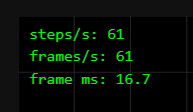
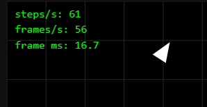

# Лабораторна робота №1: Event Loop та ігровий цикл

Цей проєкт демонструє базову архітектуру браузерної гри, що фокусується на правильній взаємодії з однопотоковою природою JavaScript та циклом подій (Event Loop). У межах роботи реалізовано детермінований цикл симуляції, плавний рендеринг за допомогою лінійної інтерполяції та систему управління вводом.

## Архітектура рішення

- **Цикл симуляції (Fixed Timestep):** Реалізовано патерн Accumulator, що відв'язує частоту розрахунку фізики (суворо 60 ітерацій на секунду) від частоти оновлення екрана. Для запобігання ефекту "спіралі смерті" (death spiral) при тимчасових підвисаннях застосовано обмеження (clamp) максимального значення різниці в часі до 0.25 с.

- **Рендеринг:** Відмальовування відбувається за допомогою `requestAnimationFrame` з урахуванням `devicePixelRatio` для забезпечення чіткості графіки. Положення об'єктів на екрані розраховується через інтерполяцію (`alpha`) між попереднім та поточним станом симуляції, що гарантує плавний рух навіть на моніторах з частотою 120+ Hz.

- **Ізоляція стану:** Управління клавіатурою інкапсульовано через механізм замикання (closure), що дозволяє зберігати поточний стан натиснутих клавіш без використання глобальних змінних.

## Експеременти

Показники до


### Експеримент 1: Синхронне блокування потоку

У `src/main.ts` всередині функції `render` додано код, який раз на 60 кадрів виконує важку синхронну роботу:

```TypeScript
// Блокуємо потік на 100 мс
if (Math.random() < 0.016) {
  const t = performance.now();
  while (performance.now() < t + 100) {}
}
```



JavaScript використовує єдиний потік (Call Stack) для виконання коду. Оскільки Event Loop може забрати наступну задачу з черги макро- або мікрозадач лише тоді, коли стек викликів повністю порожній, браузер фізично не здатний виконати фазу відмальовування (paint) або обробити події клавіатури до завершення синхронного циклу `while`.

### Експеримент 2: Порівняння `setInterval` та `requestAnimationFrame`

- **Умови:** Механізм планування кадрів змінено з `requestAnimationFrame` на `setInterval(frame, 16)`. Проведено тестування при перемиканні на фонову вкладку на 5 секунд.

- **Спостереження:** Час виконання кадру (frame time) стає нестабільним, з'являється джиттер. Після повернення з фонової вкладки спостерігається різкий стрибок у розрахунках часу через накопичення викликів.

- **Аналіз:** `setInterval` розміщує колбеки у черзі макрозадач (Task Queue) безвідносно до готовності дисплея оновити картинку, що призводить до втрати синхронізації (16 мс ≠ 16.667 мс). Натомість `requestAnimationFrame` є специфічним кроком рендерингу, який браузер викликає безпосередньо перед наступним відмальовуванням (paint) і який автоматично призупиняється або оптимізується у фонових вкладках.

### Експеримент 3: Детермінованість при фіксованому та змінному кроці (Timestep)

- **Умови:** Проведено порівняння кінцевих координат корабля після 5 секунд безперервного прискорення. Тестування відбувалося за нормальних умов та при штучному уповільненні процесора (6x CPU throttling).

- **Спостереження (змінний крок):** За відсутності акумулятора (коли час кадру `dt` безпосередньо передається у фізичний рушій) траєкторія та фінальні координати корабля на повільному CPU суттєво відрізнялися від еталонних.

- **Спостереження (фіксований крок):** При поверненні механізму Accumulator симуляція показала ідентичні кінцеві координати як за нормальних умов, так і при 6x throttling.

- **Аналіз:** Застосування реального часу кадру (`dt`) робить симуляцію недетермінованою: великі значення `dt` при падінні FPS призводять до похибок інтегрування у розрахунках швидкості та позиції. Фіксований крок гарантує математичну точність і повторюваність результатів незалежно від потужності клієнтської машини, що є критично важливою вимогою для майбутньої мережевої синхронізації.
